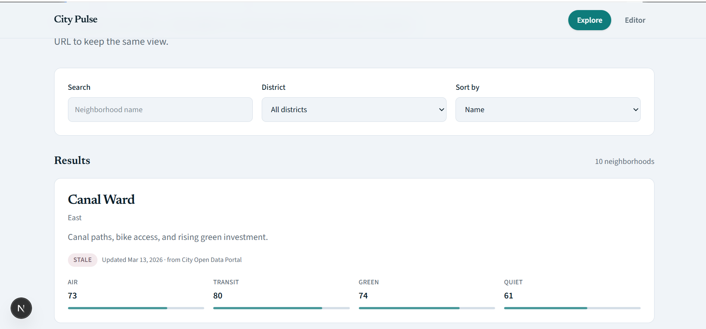

# City Pulse

Explore neighborhoods through clearer livability signals — air quality, transit, green space, and quietness.

> Open-data inspired frontend demo focused on **performance patterns, accessibility, and clean architecture**.

**Live demo:** _Coming soon_ <!-- replace with your Vercel URL -->

---

## Screenshots

<!-- Add images after capture:



-->

| Home | Explore | Place detail |
| --- | --- | --- |
| Brand-first hero | URL-synced filters + results | Metrics + air-quality trend |

---

## What this demonstrates

- **Next.js App Router + TypeScript** with a production-shaped project structure
- **URL as state** (`nuqs`) so explore filters are shareable and refresh-safe
- **TanStack Query** for client data fetching, caching, and loading/error UI
- **Server Components + `"use cache"`** on place detail for prerender-friendly data
- **Accessibility** — skip link, landmarks, labeled filters, live result updates, reduced-motion-aware skeletons
- **Feature-based folders** — thin routes, thick features, shared UI/lib
- **Typed domain model** for places/districts/sort options

---

## Features

### Home (`/`)
Brand-first landing with a single clear CTA into exploration.

### Explore (`/explore`)
- Search by neighborhood name
- Filter by district
- Sort by air / transit / green / quietness
- Loading skeletons, empty state, and error state
- Shareable query strings, e.g. `/explore?district=north&sort=airQuality`

### Place detail (`/place/[id]`)
- Livability metrics with visual bars
- Air-quality trend summary
- Cached server fetch + Suspense-friendly rendering
- Custom not-found state for unknown IDs

---

## Tech stack

| Area | Choice |
| --- | --- |
| Framework | Next.js 16 (App Router) |
| Language | TypeScript |
| Styling | Tailwind CSS v4 + design tokens |
| Server state (client) | TanStack Query |
| URL state | nuqs |
| Fonts | Outfit + Source Sans 3 |

---

## Architecture

```text
app/                     # routes only (composition)
  explore/
  place/[id]/
features/
  explore/               # filters, list UI, query keys, fetch helpers
  place/                 # detail UI + cached getPlace
shared/
  data/places.ts         # mock dataset (swap for real API later)
  lib/                   # formatters, cn helper
  providers/             # QueryProvider
  Design choice: Explore is interactive/client-driven (filters + Query). Place detail is server-first and cacheable. That split mirrors real product boundaries.

Getting started
Requirements
Node.js 20.9+
npm
Run locally

npm install
npm run dev
Open http://localhost:3000.

Scripts

npm run dev      # development server
npm run build    # production build
npm run start    # run production build
npm run lint     # ESLint

Sample flows to try
Home → Explore neighborhoods
Filter district=east and sort by transitScore
Open Harbor Line
Use keyboard only: Tab to skip link, navigate header, filters, and result links


