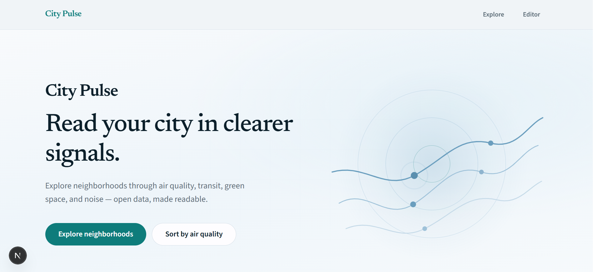
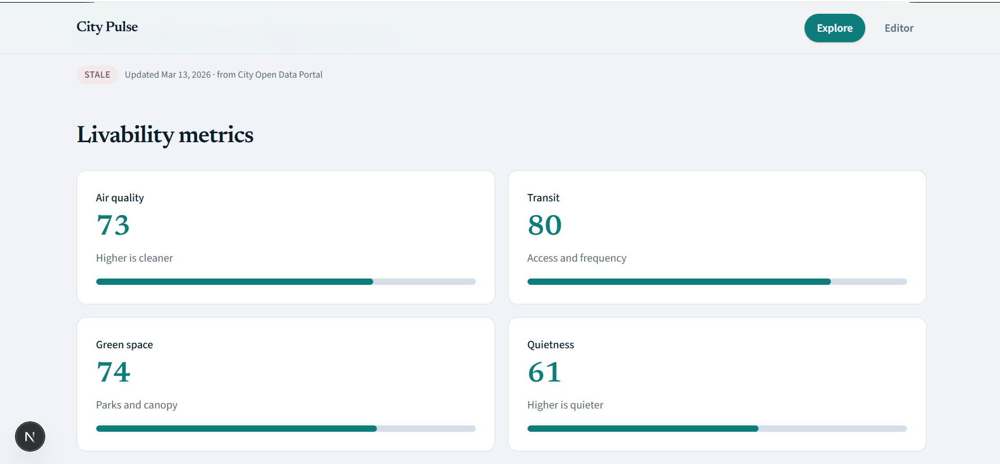

# City Pulse

Explore neighborhoods through clearer livability signals — air quality, transit, green space, and quietness.

> Open-data inspired frontend demo focused on **performance patterns, accessibility, and clean architecture**.

**Live demo:** _Coming soon_ <!-- replace with your Vercel URL -->

---

## Screenshots

<!-- Add images after capture:



-->

| Home | Explore | Place detail |
| --- | --- | --- |
| Brand-first hero | URL-synced filters + results | Metrics + air-quality trend |

---

## What this demonstrates

- **Next.js App Router + TypeScript** with a production-shaped project structure
- **URL as state** (`nuqs`) so explore filters are shareable and refresh-safe
- **Debounced search** to reduce unnecessary fetches while typing
- **TanStack Query** for client data fetching, caching, and loading/error UI
- **Server Components + `"use cache"`** on place detail for prerender-friendly data
- **Zod** validation for the places dataset contracts
- **Vitest** coverage for filter/sort helpers
- **Shared UI primitives** (`Button`, `Input`, `Select`) with a `cn()` helper
- **Accessibility** — skip link, landmarks, labeled filters, live result updates, reduced-motion-aware skeletons
- **Feature-based folders** — thin routes, thick features, shared UI/lib
- **CI** — lint, test, and build on pull requests

---

## Features

### Home (`/`)
Brand-first landing with a signal visual and clear CTAs into exploration.

### Explore (`/explore`)
- Search by neighborhood name (debounced)
- Filter by district
- Sort by air / transit / green / quietness
- Loading skeletons, empty state, and error state
- Shareable query strings, e.g. `/explore?district=north&sort=airQuality`

### Place detail (`/place/[id]`)
- Livability metrics with visual bars
- Air-quality trend chart
- Cached server fetch + Suspense-friendly rendering
- Custom not-found state for unknown IDs

---

## Tech stack

| Area | Choice |
| --- | --- |
| Framework | Next.js 16 (App Router) |
| Language | TypeScript |
| Styling | Tailwind CSS v4 + design tokens |
| Server state (client) | TanStack Query |
| URL state | nuqs |
| Validation | Zod |
| Testing | Vitest |
| Fonts | Newsreader + Source Sans 3 |

---

## Architecture

```text
app/                     # routes only (composition)
  explore/
  place/[id]/
features/
  explore/               # filters, list UI, query keys, fetch helpers
  place/                 # detail UI + cached getPlace
shared/
  data/places.ts         # Zod-validated mock dataset
  lib/                   # formatters, cn helper, schemas
  providers/             # QueryProvider
  ui/                    # shared Button, Input, Select
```

**Design choice:** Explore is interactive/client-driven (filters + Query). Place detail is server-first and cacheable. That split mirrors real product boundaries.

---

## Getting started

### Requirements
- Node.js 20.9+
- npm

### Run locally

```bash
npm install
npm run dev
```

Open [http://localhost:3000](http://localhost:3000).

### Scripts

```bash
npm run dev      # development server
npm run build    # production build
npm run start    # run production build
npm run lint     # ESLint
npm test         # Vitest unit tests
```

---

## Sample flows to try

1. Home → **Explore neighborhoods**
2. Filter `district=east` and sort by `transitScore`
3. Open **Harbor Line**
4. Use keyboard only: Tab to skip link, navigate header, filters, and result links

---

## Product decisions

| Decision | Why |
| --- | --- |
| Mock dataset first | Keeps UI/architecture as the highlight; easy to replace with a real API |
| URL-synced filters | Shareable views + better UX than local-only state |
| Debounced search | Avoids fetch thrash while typing |
| Artificial delay on explore fetch | Makes loading/empty/error states visible for demo quality |
| Cached place fetch | Aligns with Next Cache Components and faster detail navigations |
| No map in v1 | Avoids heavy deps; list + metrics already prove the frontend craft |

---

## Roadmap (optional next)

- [ ] Deploy to Vercel + add live demo link
- [ ] Add README screenshots
- [ ] Replace mock data with a public open-data API
- [ ] Lighthouse notes (perf / a11y scores)

---

## License

MIT
